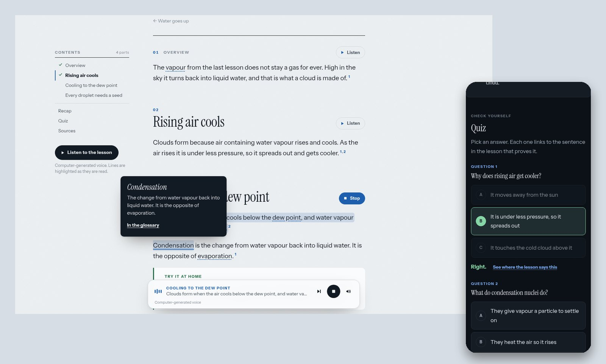

# course-studio

Turn source material into a complete, narrated lesson site that works on any static host.



You give it the source material: your documents, notes or papers, or an outline plus the sources it should draw on. The lessons are written as small JSON files of blocks (headings, paragraphs, lists, callouts, worked examples, figures, code, quotes), each citing its sources. course-studio checks them, records every readable line with a local text-to-speech voice, and builds a static site: an index with reading progress, lesson pages with contents, read-aloud per section, a recap to play, a quiz whose answers link to the sentence that proves them, a glossary with underlined terms, full-text search and the next lesson. Nothing is uploaded and no paid service is used.

It is packaged as a [Claude Code](https://claude.com/claude-code) skill (`SKILL.md` tells the assistant how to plan, write, cite and check a course), and it also works by hand from the command line.

## What you get

- **`course`**, a command line: `check`, `new`, `lint`, `narrate`, `video`, `build`, `serve`, `verify`, `test`.
- **A lint that guards the content**: blocks that state numbers or research claims without a source, sources that are cited but not listed, lessons, paragraphs and sentences that are too long, `[[terms]]` missing from the glossary, quiz answers whose "proof" sentence is not in the lesson or does not say the answer, broken lesson, section, glossary and file links, figures without useful alt text, missing or unsafe images. It also prints every claim marked `confirm` (not traced to a source) for a person to check.
- **A built site** that is plain HTML, one stylesheet, two self-hosted fonts and a few small ES modules (16 KB of script gzipped, 8 KB of CSS gzipped for the example):
  - index with lessons, minutes, progress, "continue" and a reset
  - lesson pages with a contents rail (it folds shut on phones and ticks off what you have read), "Listen" on every section, "Listen to the lesson" as a queue with skip and stop, the line being read highlighted, a voice on/off switch and a note that the voice is computer-generated
  - glossary terms underlined the first time they appear, with a popover (mouse, touch and keyboard; Escape closes it)
  - a quiz per lesson with feedback and a "See where the lesson says this" link that scrolls to the proving sentence and highlights it
  - search over every section and glossary term, with typo tolerance, opened with the Search button or `/`
  - numbered citations linking to each lesson's sources
  - light and dark themes (follows the system, with a switch), reduced motion respected, works from 320 px wide, keyboard accessible
  - reading progress and quiz scores kept in the browser's local storage, nothing sent anywhere
  - relative links only, so it works in a sub-folder (for example a GitHub Pages project site) as well as at a domain's root
- **A verify step** for the built site: every link and anchor resolves, nothing loads from another server, page and asset sizes, every narrated line on every page has its recording (found by hashing the page text exactly as the player does), no empty, short or silent recordings, and accessibility basics (lang, title, one h1, heading order, alt text, labels, button and link names, duplicate ids, captions on video).
- **`examples/how-rain-forms/`**, a 3-lesson course written for this repository from public USGS and UCAR pages, with its narration (51 lines, 252 seconds, 983 KB) and its built site in `dist/`.

## Limits

- **Static only.** There are no accounts, no server and no progress shared between devices or browsers. Clearing site data clears progress.
- **Narration only for text known at build time.** Each line is a pre-recorded file named by a hash of its text. Edit a sentence and it has no recording until you run `course narrate` again (`course verify` reports it). Search results, quiz feedback and glossary popovers are not narrated.
- **The voice is Kokoro's.** A fixed set of voices, no voice cloning, and pronunciations you may need to fix in `voice.say`. Someone has to listen to it: no tool here can judge how it sounds.
- **Content drafted by an assistant must be checked by a person.** The lint catches uncited numbers and research claims, quiz answers the lesson does not support, and lists the claims marked for confirmation, but it cannot tell whether a cited source actually says what the sentence says, or whether the source is right.
- **Search is word matching**, not a language model. It finds words (with small typos and the start of the last word), not meanings.
- **It needs to be served over HTTP.** Opened from disk as `file://`, the pages and their text read fine, but browsers refuse to run the page's ES modules there, so read-aloud, the quiz, glossary popovers, search and progress do not work. Use `course serve` locally, or any static host.
- **Lesson video is optional and simple**: a title card, the lesson's section titles over the recap, and a closing card, made by reel-studio. It is not a filmed or illustrated video.
- English text handling (sentence splitting, word stems in search). Other languages build, but search and the length checks are cruder.
- Tested on Linux only (see "What was tested").

## Requirements

| Needed | Why | Licence |
|---|---|---|
| Node.js 18 or newer | runs the command line, the build and the tests | MIT |
| [site-narrator](https://github.com/VinVirtual/site-narrator) | records the narration (`course narrate`) and provides the browser player | MIT |
| what site-narrator needs: Python 3.10+, kokoro-onnx, the Kokoro v1.0 model files, an MP3 encoder (lameenc or ffmpeg) | text to speech | see site-narrator's README: kokoro-onnx MIT, Kokoro-82M Apache-2.0, phonemizer and espeak-ng GPL-3.0-or-later, lameenc LGPL-3.0-or-later |
| [reel-studio](https://github.com/VinVirtual/reel-studio) (optional) | short lesson videos (`course video`) | MIT; it needs Chrome or Chromium, playwright-core and ffmpeg, see its README |

The site you build needs none of these: it is static files.

Without site-narrator, `course build` still makes the site, with the Listen buttons left out, and `course verify --no-voice` checks it.

### Licence notes

Checked on 21 November 2026. Check again before you rely on them. This is a summary, not legal advice.

- **Bundled fonts** (`site/fonts/`): Instrument Serif (Copyright 2022 The Instrument Serif Project Authors) and Instrument Sans (Copyright 2022 The Instrument Sans Project Authors), both under the **SIL Open Font License 1.1**, as stated in the licence and copyright fields inside each font file. Neither declares a Reserved Font Name. The files here are subsets (Latin characters and common punctuation) converted to WOFF2 with fontTools. `site/fonts/OFL.txt` carries the notices and travels with the fonts into every built site.
- **site-narrator and reel-studio** are separate projects under the MIT License, called through their command lines. Their own dependencies have their own licences, listed in their READMEs.
- **The recordings in the example** were made with the Kokoro `af_heart` voice through site-narrator. Kokoro-82M is tagged Apache-2.0 on its model card; the voice files have no separate licence that could be checked.
- **The example course text and figures** were written and drawn for this repository. Its facts come from the U.S. Geological Survey's Water Science School pages and the UCAR Center for Science Education page listed in each lesson; the text paraphrases them and does not copy them.
- **Courses you make** are yours. Check the licences of the sources you quote and the images you add.

course-studio's own code is under the **MIT License** (see `LICENSE`). The bundled fonts keep their own licence.

## Install

```bash
# 1. course-studio (for Claude Code; any folder works if you only use the command line)
git clone https://github.com/VinVirtual/course-studio ~/.claude/skills/course-studio

# 2. site-narrator and its voice model (see its README for the full steps)
git clone https://github.com/VinVirtual/site-narrator ~/.claude/skills/site-narrator
python3 -m venv ~/kokoro/.venv
~/kokoro/.venv/bin/pip install kokoro-onnx lameenc
curl -L -o ~/kokoro/kokoro-v1.0.onnx https://github.com/thewh1teagle/kokoro-onnx/releases/download/model-files-v1.1/kokoro-v1.0.onnx
curl -L -o ~/kokoro/voices-v1.0.bin  https://github.com/thewh1teagle/kokoro-onnx/releases/download/model-files-v1.1/voices-v1.0.bin

# 3. optional: reel-studio, only for lesson videos (see its README)
git clone https://github.com/VinVirtual/reel-studio ~/.claude/skills/reel-studio

# 4. check
~/.claude/skills/course-studio/course check
```

The two other skills are found in their default places. To use them from somewhere else:

| Variable | Default | What |
|---|---|---|
| `COURSE_NARRATOR` | `~/.claude/skills/site-narrator` | site-narrator's folder (it must hold `narrate` and `player/player.js`) |
| `COURSE_REEL` | `~/.claude/skills/reel-studio` | reel-studio's folder (it must hold `reel`) |

site-narrator's own variables (`KOKORO_HOME`, `NARRATE_PYTHON` and so on) apply as usual.

## Quick start

```bash
C=~/.claude/skills/course-studio/course
$C new my-course            # course.json, glossary.json, lessons/01-first-lesson.json, figures/, sources/
# put the source material in my-course/sources/, then write the lessons (or ask Claude to)
$C lint my-course           # fix every error; confirm the listed claims
$C narrate my-course        # records my-course/voice/*.mp3 with site-narrator
$C build my-course          # writes my-course/dist/
$C verify my-course         # must end in "ok"
$C serve my-course          # http://127.0.0.1:4180/
```

Upload `my-course/dist/` to any static host. Commit `voice/` with the course so recordings are not made again.

### The example

```bash
$C serve ~/.claude/skills/course-studio/examples/how-rain-forms     # then open http://127.0.0.1:4180/
$C verify ~/.claude/skills/course-studio/examples/how-rain-forms
```

## Commands

| Command | What it does |
|---|---|
| `course check` | checks Node, finds site-narrator (and runs `narrate check`) and reel-studio, and says how to fix what is missing |
| `course new <dir>` | copies the template course into `<dir>` (refuses if it already holds a `course.json`) |
| `course lint [dir]` | checks the course (see "Lint rules"), prints the claims to confirm, exits non-zero on errors. `--strict` fails on warnings, `--json` prints JSON |
| `course narrate [dir]` | runs lint, writes `voice-lines.json` and `narrate.json`, then `narrate record` (2 workers) and `narrate verify`. Only new and changed lines are recorded; recordings of removed lines are deleted. `--dry-run` shows the plan, `--force` records everything |
| `course video [dir] [lesson ...]` | optional: writes a reel-studio project in `<dir>/video/` and renders a short landscape video per lesson (or the ones named) with its web copy, poster and captions. `course build` then adds them to the lesson pages |
| `course build [dir]` | writes the site to `<dir>/dist` (`--out` elsewhere). Refuses when lint has errors; `--force` builds anyway |
| `course serve [dir]` | serves the built site on `http://127.0.0.1:4180` (`--port N`). Local use only: it listens on this machine, answers only `localhost` requests and refuses dot-files |
| `course verify [dir]` | checks the built site (see "What verify checks"), prints sizes and narration totals, exits non-zero on errors. `--no-voice` when the course has no narration, `--out` for another folder, `--json` |
| `course test` | runs the unit tests (plain `node --test`, no extra packages) |

`dir` is a folder holding `course.json` (default: the current folder). Unknown options are errors, so a typo stops the command instead of changing what it does.

## Content format

```
my-course/
  course.json          title, audience, lessons in order, theme, voice
  glossary.json        [{ term, aliases?, definition, lesson? }]
  lessons/01-name.json one file per lesson
  figures/*.svg        diagrams (inlined, they follow the theme)
  sources/             the source material (not published)
  voice/               recordings made by course narrate
  dist/                the built site
```

### course.json

| Field | Meaning |
|---|---|
| `title`, `subtitle`, `audience`, `author`, `language` | shown on the index; `language` is the page's `lang` (default `en`) |
| `lessons` | the lesson files, in reading order |
| `glossary` | the glossary file (default `glossary.json` when it exists) |
| `theme` | `{ "preset": "paper" | "ink" | "moss", "accent": "#1f6f8b" }`: warm newsprint with clay red, cool blue-grey with cobalt, or lichen green; `accent` overrides the accent colour |
| `voice` | `{ "voice": "af_heart", "speed": 0.96, "say": { "NOAA": "Noah" }, "lang": "en-us", "bitrate": 32 }`, passed to site-narrator |
| `limits` | `{ "lessonWords": 1400, "paragraphWords": 120, "sentenceWords": 35, "recapLines": 6 }` for lint |
| `video` | options for `course video`: `format` (`embed` by default, or `landscape`, `square`, `vertical`), `music` (false), `captions` (true), `speed`, `workers` (2) |
| `footer` | the line at the bottom of each page |

### A lesson

```json
{
  "id": "clouds",
  "title": "Clouds are made of droplets",
  "summary": "One or two sentences for the index and the lesson header.",
  "blocks": [
    { "type": "heading", "text": "Rising air cools" },
    { "type": "paragraph", "text": "Clouds form when the air cools below the [[dew point]].", "cite": ["ucar-clouds"] }
  ],
  "takeaways": ["Below the dew point, vapour condenses into liquid water."],
  "recap": ["Damp air rises, spreads out and cools."],
  "quiz": [
    { "question": "Why does rising air get cooler?", "options": ["...", "...", "..."], "answer": 1,
      "proof": "As the air rises it is under less pressure, so it spreads out and gets cooler." }
  ],
  "sources": [
    { "id": "ucar-clouds", "title": "Clouds and How They Form", "publisher": "UCAR Center for Science Education",
      "url": "https://scied.ucar.edu/learning-zone/clouds/how-clouds-form", "accessed": "2026-11-21" }
  ]
}
```

Block types and their fields (every block except `heading` and `code` takes `cite` and `confirm`):

| Type | Fields | Read aloud |
|---|---|---|
| `heading` | `text` (starts a section) | yes |
| `paragraph` | `text` | yes |
| `list` | `items`, `ordered` | each item |
| `callout` | `text`, `title`, `tone` (`note`, `tip`, `warning`) | title and text |
| `example` | `title`, `steps`, `result` (a worked example) | title, each step, result |
| `figure` | `src`, `alt`, `caption`, `width`, `height`, `credit` | the caption |
| `code` | `text`, `lang`, `caption` | no |
| `quote` | `text`, `by` | the text |

`takeaways` are shown as a list. `recap` lines are read with "Play the recap". `quiz[].proof` is a sentence copied from the lesson. A source needs `id`, `title` and `url` (or `citation` for something with no address); `publisher` and `accessed` are shown when given. `"confirm": "why"` on a block marks a claim the writer could not trace to a source: lint lists it for a person to check.

Inline markup in any text: `[[term]]`, `[[shown|term]]`, `[label](https://...)`, `[label](lesson:id)`, `[label](lesson:id#section-id)`, `[label](glossary:term)`, `[label](#section-id)`, `[label](handout.pdf)` (a file in the course folder, copied into the site), and `\[` `\]` for literal brackets. Glossary terms are also found and underlined automatically the first time they appear in a lesson.

### Figures

SVG figures are inlined into the page and use classes instead of colours, so they follow the theme: fills `c-ink`, `c-soft`, `c-faint`, `c-accent`, `c-paper`, `c-sunk`, `c-rule`, `c-tint`, `c-good`; strokes `s-ink`, `s-soft`, `s-accent`, `s-rule`; text `t-serif`, `t-soft`, `t-accent`. Scripts, event handlers, external references and `foreignObject` are rejected by lint and stripped when inlining. PNG, JPEG, WebP and AVIF are copied into the site and need `width` and `height`.

## Lint rules

| Rule | Level | When |
|---|---|---|
| `shape` | error | a missing or unknown field, an unknown block type, a quiz `answer` out of range |
| `no-sources`, `unknown-source`, `bad-source-url` | error | a lesson with no sources, a `cite` id not in the lesson's sources, a source URL that is not http(s) |
| `uncited-claim` | error | a block with a digit, a percentage, a quantity word (hundreds, millions...) or research wording (study, research, survey, according to, on average, estimated) and no `cite` |
| `unconfirmed-claim` | warning | the same, marked `confirm`: listed for the user |
| `uncited`, `unused-source` | warning | prose with no citation, a source nobody cites |
| `lesson-too-long`, `paragraph-too-long`, `sentence-too-long`, `recap-too-long` | warning | past the `limits` |
| `no-recap`, `no-takeaways`, `no-quiz` | warning | a lesson without them |
| `undefined-term`, `unknown-lesson` | error | a `[[term]]` not in the glossary, a glossary entry pointing at a lesson that does not exist |
| `unused-term` | warning | a glossary entry that no lesson uses |
| `proof-not-found` | error | a quiz `proof` that is not a sentence of the lesson (quote style, dashes and white space are ignored) |
| `answer-not-in-proof` | warning | less than half of the right answer's words are in the proof or the question |
| `duplicate-option` | error | two quiz options are the same |
| `broken-link` | error | a lesson, section, glossary term, anchor or file that does not exist, or a scheme other than https, http, mailto, lesson, glossary |
| `missing-image`, `remote-image`, `unsafe-svg`, `image-type` | error | a figure file that is missing, on another server, contains scripts or event handlers, or is not SVG, PNG, JPEG, WebP, AVIF or GIF |
| `weak-alt`, `alt-is-caption`, `image-size` | warning | alt text that is short or generic or repeats the caption, a raster image without dimensions |

## What verify checks

- every `href`, `src` and `poster` in the built pages resolves to a file inside the site, and every `#anchor` to an element id
- no script, stylesheet, image, video or font is loaded from another server (links to sources are fine), including `url()` and `@import` in CSS and `fetch()`/`import()` in scripts
- one page over 200 KB, scripts over 80 KB gzipped, CSS over 30 KB gzipped (warnings)
- every `[data-line]` element's text has `voice/<hash>.mp3`; recordings under 1.5 KB, shorter than 0.3 s or silent by the manifest's level are errors; recordings no page uses are warnings
- `lang`, `<title>`, viewport, exactly one `<h1>`, no skipped heading level, `alt` on images, a name for `role="img"`, buttons, links and inputs, no duplicate ids, a captions track on video

## How it works

1. **Load and lint** (`cli/lib/load.mjs`, `lint.mjs`): the course is read into lessons of blocks. Inline markup is parsed into plain text plus marks (`text.mjs`), so the text a reader sees, the text that is recorded and the text the quiz proofs are matched against are the same string.
2. **Narrate** (`narrate.mjs`): the lines are collected in reading order (`blocks.mjs`: each section's heading and lines, then the recap) into `voice-lines.json`, and site-narrator records each into `voice/<key>.mp3`, where the key is 32-bit FNV-1a of the tidied text plus its length.
3. **Build** (`build.mjs`, `pages.mjs`, `blockhtml.mjs`, `inline.mjs`): each line is rendered inside its own `<span data-line>`, with glossary buttons, links and proof sentences nested inside it and citation numbers outside it, so the span's `textContent` is exactly the recorded line. The player (copied from site-narrator) hashes that text to find the file. The search index (`assets/search.json`) holds one entry per section, lesson and glossary term; `site/js/search-core.js` is shared by the build and the browser.
4. **Verify** (`verify.mjs`, `html.mjs`): the built HTML is scanned back, the `data-line` text is hashed the same way, and every link, asset and recording is checked on disk.

## What was tested

On one Linux machine (Node 24, Google Chrome headless through Playwright, site-narrator with kokoro-onnx and the ffmpeg encoder):

- `course test`: 62 unit tests for inline markup parsing, the voice hash (also against the installed site-narrator player), loading and shape checks, sections and spoken lines, every lint rule, glossary marking, quiz proof matching, rendering and nesting of marks, the HTML scanner, search (typos, prefixes, ranking, snippets), progress storage, link and anchor checking, third-party detection, accessibility checks, narration checks, the local server's path rules, and full builds of the example with and without site-narrator.
- The example was linted (0 errors, 0 warnings, one claim listed to confirm), narrated (51 lines, 252 s, 983 KB; `narrate verify` ok), built and verified (`ok`).
- The built example was opened in headless Chrome at 1440, 768, 390 and 320 px wide in light and dark: no horizontal overflow, no console errors, no request to any other origin. In the browser: a glossary popover opened by click and by keyboard (focus moved into it, Tab reached its link, Escape closed it and returned focus); a section's Listen read its heading and paragraph in order with the line highlighted; "Listen to the lesson" queued all sections, "Next section" skipped to the next one, the voice switch and Stop worked; the recap played its three lines; the quiz gave "right" and "not quite" feedback, the score was saved, and the proof link focused and highlighted the sentence; search found "Coalescence" from the typo "coalesense" and arrow keys moved through the results; reading to the end marked the lesson read, and the index showed it with the quiz score and pointed "Continue" at the first unread lesson; the theme choice survived a reload; reduced motion shortened transitions.
- `course video` was run on one lesson of a copy of the example: reel-studio rendered a 25.6 s 1280×720 web copy with captions and a poster (563 KB, mean volume −23.1 dB), `course build` added it to the lesson page with a captions track, and it played in headless Chrome. It is not part of the committed example.

Not tested: macOS and Windows; Firefox and Safari; real phones and screen readers; a real static host (only the local server); languages other than English. Nobody has listened to the recordings as part of these checks: listen to yours.

## Development

```bash
./course test                                   # unit tests
./course lint examples/how-rain-forms
./course build examples/how-rain-forms && ./course verify examples/how-rain-forms
```

The browser code is in `site/js/` (no build step, no dependencies). The command line is in `cli/`. Text handling that can be tested without a browser or a voice model lives in `cli/lib/` and `site/js/search-core.js`, `site/js/progress-core.js`.
